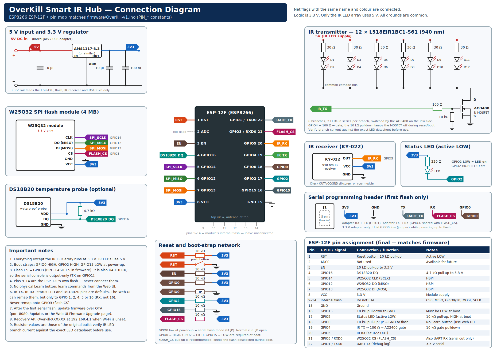

# OverKill Smart IR Hub

OverKill is a DIY universal infrared (IR) hub built around an ESP8266. It is designed to give existing IR-controlled appliances—such as TVs, air conditioners and fans—smart control without requiring you to buy an expensive branded IR hub.

The project combines a compact, PETG-printed enclosure with a browser-based setup interface, external flash storage for learned commands, MQTT, Home Assistant integration, an optional temperature probe, and an Alexa Smart Home cloud bridge.

## What you can build

- **Learn and replay IR commands:** use the receiver to capture commands from an appliance's original remote, then replay them from the hub.
- **Manage devices locally:** use the hub's Web UI to organize remotes and commands, configure Wi-Fi and MQTT, and manage supported rules and schedules.
- **Choose a Home Assistant path:** use the firmware's native MQTT discovery for Home Assistant entities, or select the OverKill Smart Hub custom integration for its richer hub integration and Alexa cloud bridge. These discovery modes are separate choices.
- **Choose an Alexa path:** local Emulated Hue can expose individual learned commands as on/off light switches; the Alexa Smart Home cloud path exposes whole device types and supports richer remote commands.
- **Add temperature-aware behaviour:** the enclosure and firmware support the waterproof DS18B20 temperature probe.
- **Build and repair it yourself:** the enclosure model, component links, firmware and setup instructions are provided so you can understand the hardware rather than depend on a closed commercial hub.

## What to expect

This is a DIY build, not a plug-and-play retail product. You should expect to source the components, assemble and test the electronics, print the enclosure in PETG, flash the firmware and configure the local MQTT/Home Assistant path. Alexa voice control adds separate Amazon/AWS account and cloud setup, and requires an internet connection. The hub's local Web UI and local MQTT/Home Assistant path are intended for local control; Alexa's cloud voice path is not fully local.

The author's build is based on a **D1 mini ESP8266 development board**, which provides 3.3 V regulation. The alternative bare ESP-12F build needs a suitable external 5 V-to-3.3 V regulator. The intended pin map is explicit in the committed diagram and compile-time firmware settings: W25Q32 flash CS is GPIO3 (D1 mini RX), the single status LED is GPIO2 (D4, active LOW), IR TX is GPIO4, IR RX is GPIO5, and DS18B20 data defaults to GPIO16. Learning starts in the Web UI and uses the IR receiver; there is no physical learn button. The underside reset button connects to the board's dedicated RST pad, not a general GPIO. Because GPIO3 is also UART0 RX, test storage, boot and serial-programming behavior on the actual D1 mini before calling the physical build validated.

## Product and hardware preview

### Enclosure and physical layout


The enclosure image shows the three top-plate openings for the **DS18B20 temperature probe**, **IR receiver used for learning**, and **status LED**. It also identifies the side provision for the USB-C 5 V power input and the reset access underneath the device.

[Open the printable `Overkill.3mf` model](3d_printing/Overkill.3mf). Print the enclosure in **PETG**; the image is a visual reference, not a substitute for the 3MF.

### Connection diagram



The diagram is the wiring reference for the electronics. It uses ESP-12F GPIO names, while the author's physical build uses a D1 mini, so follow the [D1 mini pin-map notes](hardware/PIN-MAP.md) when wiring that board.

> [!CAUTION]
> The intended wiring in the compile-time firmware setting and committed circuit diagram is **W25Q32 CS → GPIO3/RX** and **single status LED → GPIO2/D4 (active LOW)**. The Stage Info diagnostic is stale and reports GPIO15 for flash CS; the code's pin constant and diagram specify GPIO3. GPIO3 is also UART0 RX on the D1 mini, so test the actual board's flash operations, boot and serial-programming/debug workflow before treating the physical build as validated. There is no physical learn button (use the Web UI and IR receiver), and the underside reset button uses the dedicated RST pad.

## Indicative component cost

As a rough reference, six major component line items total about **US$3.34**, converted from the supplier's Indian retail prices using **US$1 = ₹94.76** (reference rate dated 25 October 2026). This is a partial materials subtotal—not the cost of a complete working hub.

| Major component | Approx. price in USD |
|---|---:|
| [D1 mini ESP8266 board](https://quartzcomponents.com/products/wemos-d1-mini-esp8266-nodemcu-mini-d1-module) | $1.52 |
| [W25Q32 4 MiB flash module](https://quartzcomponents.com/collections/all/products/w25q32-32mbit-capacity-flash-storage-module) | $0.60 |
| [Waterproof DS18B20 temperature probe](https://quartzcomponents.com/collections/all/products/ds18b20-water-proof-temperature-sensor) | $0.36 |
| [12 × 940 nm IR LEDs](https://quartzcomponents.com/products/l518eir1bc1-s61-940nm-5mm-infrared-ir-transmitter-led) | $0.57 |
| [AO3400 MOSFET](https://quartzcomponents.com/products/ao3400-mosfet-30v-5-8a-a09t-sot-23-c-n-channel-smd-package) | $0.05 |
| [USB-C 4-pin power breakout](https://quartzcomponents.com/collections/all/products/usb-3-1-female-socket-type-c-connector-4-pin-breakout-pcb-board) | $0.24 |
| **Subtotal for these six line items** | **$3.34** |

*The prices are converted from [Quartz Components' Indian listings](https://quartzcomponents.com/) using a [USD/INR reference rate of ₹94.76 per US dollar](https://exchangeratetool.com/historical/usd-inr) for 25 October 2026. This is an illustration for international readers, not a worldwide quote.* It excludes the IR receiver, status LED, resistors, capacitors, wiring, 5 V supply and cable, PETG filament and print waste, tools, shipping, taxes, and any optional regulator. Local prices and import costs will vary; the linked IR LED listing was shown as sold out when checked.

The sections below walk through the hardware, firmware, the Home Assistant discovery choices, the Alexa connection options, AWS IoT certificates and cloud Alexa setup in detail.

**Reproducible-build status:** the documented board is a D1 mini, the external W25Q32 flash is 4 MiB, and IRremoteESP8266 is pinned to 2.9.0. The ESP8266 Arduino core version and actual internal flash size/layout still need to be recorded from a successful target-board build; see [Firmware installation and initial hub configuration](docs/FIRMWARE.md). No verified precompiled firmware binary is supplied.

## Build journey

1. **Source parts and print the enclosure** — use the linked BOM, the original 3MF and PETG printing guide.
2. **Assemble and flash the hub** — wire the components, install the firmware, then configure Wi-Fi and the local Web UI.
3. **Choose Home Assistant discovery** — use native Home Assistant MQTT discovery for entities only, or select Custom Integration and install the companion integration for its added features and Alexa cloud path.
4. **Choose Alexa control (optional)** — expose individual commands through local Emulated Hue, or set up the cloud Smart Home skill, AWS IoT bridge and Lambda for device-aware remote commands. The cloud path requires the custom integration.

## Build and setup guides

1. [**Hardware, BOM, assembly and 3D printing**](docs/HARDWARE.md) — parts with exact supplier links, power/driver safety, pin conflict and enclosure fit.
2. [**Firmware and first boot**](docs/FIRMWARE.md) — Arduino environment, flashing, recovery AP, Web UI, MQTT and remote learning.
3. [**Home Assistant: native MQTT vs custom integration**](docs/CUSTOM_INTEGRATION.md) — discovery-mode differences, installation, MQTT transports and when the custom integration is needed.
4. [**Alexa and Home Assistant connection options**](docs/ALEXA_OPTIONS.md) — side-by-side comparison of native MQTT, the custom integration, local Emulated Hue and cloud Alexa; includes a device-type/command matrix.
5. [**AWS IoT, Lambda, account linking and Alexa**](docs/ALEXA_AWS.md) — includes a three-step copy/paste guide for the Alexa Smart Home skill, Lambda trigger/endpoint and Login with Amazon account linking, plus certificates and troubleshooting.
6. [**3D printing / PETG guide**](3d_printing/README.md) — enclosure model status, PETG material and test-fit steps.
7. [**Release checklist**](docs/RELEASE_CHECKLIST.md) — hardware, firmware, cloud and packaging gates.

## Architecture

```text
Alexa Smart Home skill
  -> Login with Amazon account linking
  -> AWS Lambda (alexa_lambda/index.mjs)
  -> AWS IoT Core (retained catalogue and directives)
  -> Home Assistant OverKill integration / mutual-TLS AWS bridge
  -> local or optional remote MQTT transport
  -> ESP8266 hub -> IR LED driver -> appliance
```

The cloud Alexa architecture above is optional as a feature, but **account linking through Login with Amazon is mandatory when you configure the Alexa Smart Home skill**. For local command switches, the firmware's Emulated Hue server is discovered on the LAN through SSDP and uses the learned commands enabled per command in the Web UI; it does not need this AWS/Lambda path. For cloud Alexa, the supplied Lambda uses the retained device catalogue at `alexa/config/devices` by default and publishes commands to `alexa/{hub}/directive`. It requires the `IOT_ENDPOINT` environment variable. The Home Assistant integration's AWS bridge uses a separate X.509 certificate/key pair and connects over MQTT/TLS.

## Repository status

The firmware sources, updated Lambda, circuit diagram, labeled enclosure image and original 3MF model are committed. The diagram is [`hardware/circuit-diagram.png`](hardware/circuit-diagram.png), the labeled enclosure image is [`hardware/Overkill_labeled.png`](hardware/Overkill_labeled.png), and the printable model is [`3d_printing/Overkill.3mf`](3d_printing/Overkill.3mf). The source constant and diagram agree on flash CS = GPIO3; the remaining hardware validation is to test flash persistence, boot and serial programming on the actual D1 mini. The companion Home Assistant integration is maintained separately at [OverKill Smart Hub Integration](https://github.com/sheminasalam/OverKill-Smart-Hub-Integration). The repository still has no `LICENSE` file; `LICENSE_PENDING.md` is only a reminder, not a license.

The repository's source-check workflow validates Python syntax and JSON files. It does not compile the ESP8266 firmware or prove AWS/Alexa end-to-end behavior. The intended flash-CS pin is GPIO3 in both the source constant and diagram; the remaining hardware validation is to test W25Q32 read/write/erase and persistence, boot stability and serial programming on the actual D1 mini. The build is not yet reproducible because the ESP8266 core version and the board's internal-flash size/layout have not been recorded.

## Current Lambda source

[Open `alexa_lambda/index.mjs`](alexa_lambda/index.mjs). The committed repository version does not read `ALEXA_EVENT_CLIENT_ID`, `ALEXA_EVENT_CLIENT_SECRET` or `DELETE_LEGACY_TV_SCENES_ON_ACCEPT_GRANT`. It does not implement Alexa Event Gateway token exchange/refresh or legacy TV-scene deletion on `AcceptGrant`, so these variables have no effect on this source. Keep **Send Alexa Events** disabled unless the deployed Lambda is verified to implement and test that support. If the deployed Lambda differs, export its current source and synchronize it with this repository before describing its environment variables as supported.

## References

- [ESP8266 Arduino Core documentation](https://arduino-esp8266.readthedocs.io/en/latest/)
- [AWS IoT device and certificate setup](https://docs.aws.amazon.com/iot/latest/developerguide/create-iot-resources.html)
- [Alexa Smart Home account linking](https://developer.amazon.com/docs/alexaplus/account-linking/account-linking-for-sh-and-other.html)
- [HACS integration publication](https://www.hacs.dev/docs/publish/integration/)

Project: [sheminasalam/OverKill-Smart-IR-Hub](https://github.com/sheminasalam/OverKill-Smart-IR-Hub).
