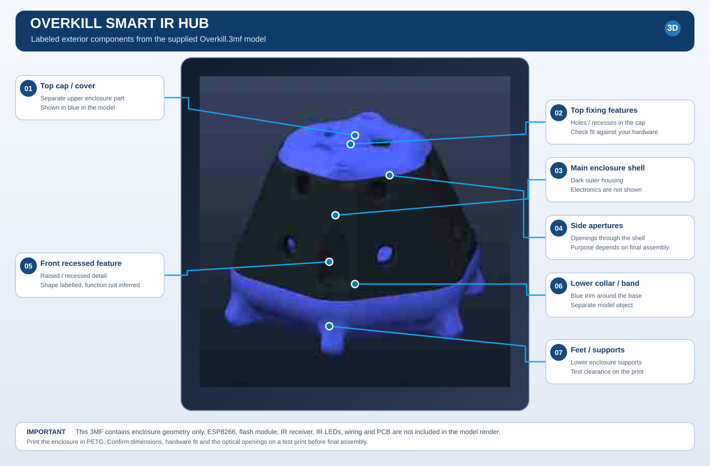

# OverKill Smart IR Hub

An ESP8266 ESP-12F universal infrared hub with IR learning/replay, external W25Q32 SPI flash storage, a local Web UI, MQTT, Home Assistant integration support, an Alexa Smart Home Lambda bridge, an optional DS18B20 sensor and a 3D-printable enclosure.

This repository is being prepared as a reproducible DIY build guide. Follow the documentation in order and keep the known hardware blocker in view.

> [!CAUTION]
> **The supplied circuit is not yet a verified final schematic.** The firmware constant sets external flash CS to GPIO3, but the supplied diagram labels it GPIO15. The status LED and button wiring also differ between code and drawing. Resolve these against the actual board before final assembly. See [Pin-map review](hardware/PIN-MAP.md) and [visual review](hardware/pin-map-review.svg).



**Enclosure printing:** print the enclosure in **PETG**. Follow [Hardware, BOM, assembly and enclosure](docs/HARDWARE.md) for preparation and test-fitting. The SVG above is a visual reference, **not** the printable 3MF file.

## Build and setup guides

1. [**Hardware, BOM, assembly and 3D printing**](docs/HARDWARE.md) — parts with exact supplier links, power/driver safety, pin conflict and enclosure fit.
2. [**Firmware and first boot**](docs/FIRMWARE.md) — Arduino environment, flashing, recovery AP, Web UI, MQTT and remote learning.
3. [**Home Assistant integration and HACS plan**](docs/CUSTOM_INTEGRATION.md) — installation, transports, hub discovery and planned dedicated HACS repository.
4. [**AWS IoT, Lambda, account linking and Alexa**](docs/ALEXA_AWS.md) — Root CA/client certificates, bridge policy, Lambda deployment, Login with Amazon account linking, skill setup and troubleshooting.
5. [**Release checklist**](docs/RELEASE_CHECKLIST.md) — hardware, firmware, cloud and packaging gates.

## Architecture

```text
Alexa Smart Home skill
  -> Login with Amazon account linking
  -> AWS Lambda (alexa_lambda/index.mjs)
  -> AWS IoT Core (retained catalogue and directives)
  -> Home Assistant OverKill integration / mutual-TLS AWS bridge
  -> local or optional remote MQTT transport
  -> ESP8266 hub -> IR LED driver -> appliance
```

The supplied Lambda uses the retained device catalogue at `alexa/config/devices` by default and publishes commands to `alexa/{hub}/directive`. It requires the `IOT_ENDPOINT` environment variable. The Home Assistant integration's AWS bridge uses a separate X.509 certificate/key pair and connects over MQTT/TLS.

## Repository status

The firmware sources, updated Lambda, core documentation and pin-map review are committed. The original 3MF enclosure and original circuit image are not yet committed to this repository. The labeled SVG above is a model-derived preview only; it cannot be used as a substitute for the 3MF. The companion integration is supplied separately for now and should be published in its own repository before HACS submission. There is no project license yet; `LICENSE_PENDING.md` is a reminder, not a license.

The repository's source-check workflow validates Python syntax and JSON files. It does not compile the ESP8266 firmware or prove AWS/Alexa end-to-end behavior. The first release remains blocked on the verified flash-CS connection, matching schematic and successful hardware tests.

## Current Lambda source

[Open `alexa_lambda/index.mjs`](alexa_lambda/index.mjs). The repository version does not use `ALEXA_EVENT_CLIENT_ID` / `ALEXA_EVENT_CLIENT_SECRET`; it does not implement event-gateway token exchange or token refresh. Keep **Send Alexa Events** disabled unless the Lambda is extended and tested.

## References

- [ESP8266 Arduino Core documentation](https://arduino-esp8266.readthedocs.io/en/latest/)
- [AWS IoT device and certificate setup](https://docs.aws.amazon.com/iot/latest/developerguide/create-iot-resources.html)
- [Alexa Smart Home account linking](https://developer.amazon.com/docs/alexaplus/account-linking/account-linking-for-sh-and-other.html)
- [HACS integration publication](https://www.hacs.dev/docs/publish/integration/)

Project: [sheminasalam/OverKill-Smart-IR-Hub](https://github.com/sheminasalam/OverKill-Smart-IR-Hub).
