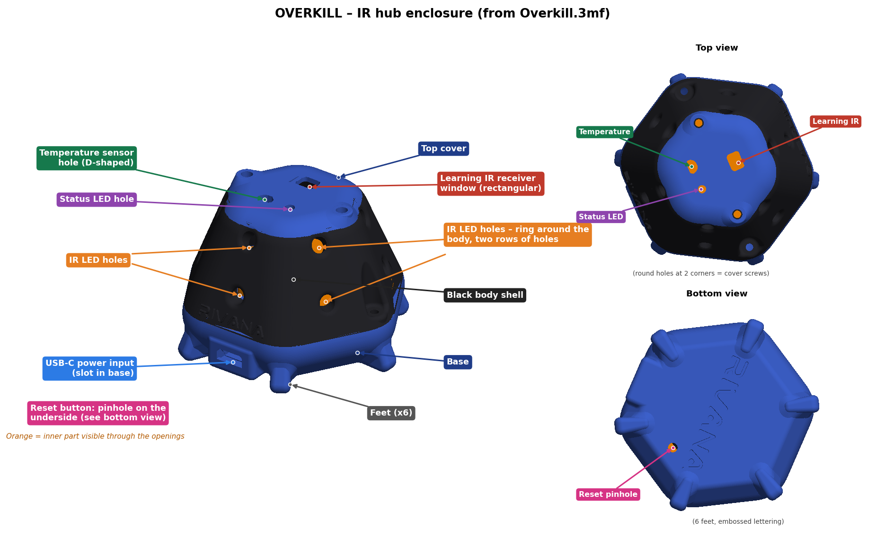

# OverKill Smart IR Hub

> **A LOW-COST, LOCAL ALTERNATIVE TO EXPENSIVE BRANDED IR HUBS**
>
> Build your own universal infrared hub from inexpensive ESP8266 hardware, commonly available components and a PETG 3D-printed enclosure. OverKill brings IR learning and replay, a local Web UI, MQTT and Home Assistant integration into a DIY device you can assemble, understand and maintain yourself—with an Alexa Smart Home cloud bridge for voice control.
>
> **The goal: affordable hardware, local control, and no dependence on a proprietary IR-hub ecosystem.**

## The cost advantage

The six major line items below add up to approximately **₹349** at the supplier prices listed when checked on **25 October 2026**:

| Major component | Listed price |
|---|---:|
| [D1 mini ESP8266 board](https://quartzcomponents.com/products/wemos-d1-mini-esp8266-nodemcu-mini-d1-module) | ₹175 |
| [W25Q32 4 MiB flash module](https://quartzcomponents.com/collections/all/products/w25q32-32mbit-capacity-flash-storage-module) | ₹57 |
| [Waterproof DS18B20 temperature probe](https://quartzcomponents.com/collections/all/products/ds18b20-water-proof-temperature-sensor) | ₹34 |
| [12 × 940 nm IR LEDs](https://quartzcomponents.com/collections/ir-sensor) at ₹4.50 each | ₹54 |
| [AO3400 MOSFET](https://quartzcomponents.com/products/ao3400-mosfet-30v-5-8a-a09t-sot-23-c-n-channel-smd-package) | ₹6 |
| [USB-C 4-pin power breakout](https://quartzcomponents.com/collections/all/products/usb-3-1-female-socket-type-c-connector-4-pin-breakout-pcb-board) | ₹23 |
| **Subtotal for these six line items** | **₹349** |

*This is a transparent reference subtotal, not the complete build cost or a guaranteed current quote.* It excludes the IR receiver, status LED, resistors, capacitors, wiring, 5 V power supply/cable, PETG filament and print waste, tools, shipping, and any optional regulator. Supplier prices, availability and taxes may change. The author's D1 mini build already includes 3.3 V regulation; a bare ESP-12F variant needs an additional 5 V-to-3.3 V regulator.

The build and setup instructions below take you from the bill of materials through assembly, firmware, Home Assistant, AWS IoT and Alexa.

> [!CAUTION]
> **Use the corrected connection diagram below.** It shows W25Q32 flash CS on GPIO3 to match the firmware constants; GPIO3 is also UART0 RX, so the diagram notes the serial-console limitation and cautions against remapping the pin. The enclosure image identifies the three top openings, USB-C 5 V input provision, and underside reset pinhole. The hardware has one status LED and no physical learning button; learning is started from the Web UI using the IR receiver. See the [pin-map notes](hardware/PIN-MAP.md).

**Connection diagram:** [Open the connection diagram (PNG)](hardware/circuit-diagram.png). It shows the ESP-12F pin names used by the firmware. A bare ESP-12F needs a suitable 5 V-to-3.3 V regulator; the author's D1 mini build already has onboard regulation. GPIO3 is also UART0 RX, so read the serial/flash-CS note in the diagram and [pin-map notes](hardware/PIN-MAP.md).



**Enclosure printing:** print the enclosure in **PETG**. Follow [Hardware, BOM, assembly and enclosure](docs/HARDWARE.md) for preparation and test-fitting. The SVG above is a visual reference, **not** the printable 3MF file.

## Build and setup guides

1. [**Hardware, BOM, assembly and 3D printing**](docs/HARDWARE.md) — parts with exact supplier links, power/driver safety, pin conflict and enclosure fit.
2. [**Firmware and first boot**](docs/FIRMWARE.md) — Arduino environment, flashing, recovery AP, Web UI, MQTT and remote learning.
3. [**Home Assistant integration and HACS plan**](docs/CUSTOM_INTEGRATION.md) — installation, transports, hub discovery and planned dedicated HACS repository.
4. [**AWS IoT, Lambda, account linking and Alexa**](docs/ALEXA_AWS.md) — Root CA/client certificates, bridge policy, Lambda deployment, Login with Amazon account linking, skill setup and troubleshooting.
5. [**3D printing / PETG guide**](3d_printing/README.md) — enclosure model status, PETG material and test-fit steps.
6. [**Release checklist**](docs/RELEASE_CHECKLIST.md) — hardware, firmware, cloud and packaging gates.

## Architecture

```text
Alexa Smart Home skill
  -> Login with Amazon account linking
  -> AWS Lambda (alexa_lambda/index.mjs)
  -> AWS IoT Core (retained catalogue and directives)
  -> Home Assistant OverKill integration / mutual-TLS AWS bridge
  -> local or optional remote MQTT transport
  -> ESP8266 hub -> IR LED driver -> appliance
```

The supplied Lambda uses the retained device catalogue at `alexa/config/devices` by default and publishes commands to `alexa/{hub}/directive`. It requires the `IOT_ENDPOINT` environment variable. The Home Assistant integration's AWS bridge uses a separate X.509 certificate/key pair and connects over MQTT/TLS.

## Repository status

The firmware sources, updated Lambda, documentation, corrected connection diagram and enclosure feature views are committed. The original 3MF is at [`3d_printing/Overkill.3mf`](3d_printing/Overkill.3mf). The connection diagram and labeled enclosure image are visual references; they do not replace the 3MF printable model. GPIO3 is shared by flash CS and UART0 RX in the current firmware, as documented in the diagram. The companion Home Assistant integration is supplied separately for now and should be published in its own repository before HACS submission. There is no project license yet; `LICENSE_PENDING.md` is a reminder, not a license.

The repository's source-check workflow validates Python syntax and JSON files. It does not compile the ESP8266 firmware or prove AWS/Alexa end-to-end behavior. The first release remains blocked on the verified flash-CS connection, matching schematic and successful hardware tests.

## Current Lambda source

[Open `alexa_lambda/index.mjs`](alexa_lambda/index.mjs). The repository version does not use `ALEXA_EVENT_CLIENT_ID` / `ALEXA_EVENT_CLIENT_SECRET`; it does not implement event-gateway token exchange or token refresh. Keep **Send Alexa Events** disabled unless the Lambda is extended and tested.

## References

- [ESP8266 Arduino Core documentation](https://arduino-esp8266.readthedocs.io/en/latest/)
- [AWS IoT device and certificate setup](https://docs.aws.amazon.com/iot/latest/developerguide/create-iot-resources.html)
- [Alexa Smart Home account linking](https://developer.amazon.com/docs/alexaplus/account-linking/account-linking-for-sh-and-other.html)
- [HACS integration publication](https://www.hacs.dev/docs/publish/integration/)

Project: [sheminasalam/OverKill-Smart-IR-Hub](https://github.com/sheminasalam/OverKill-Smart-IR-Hub).
